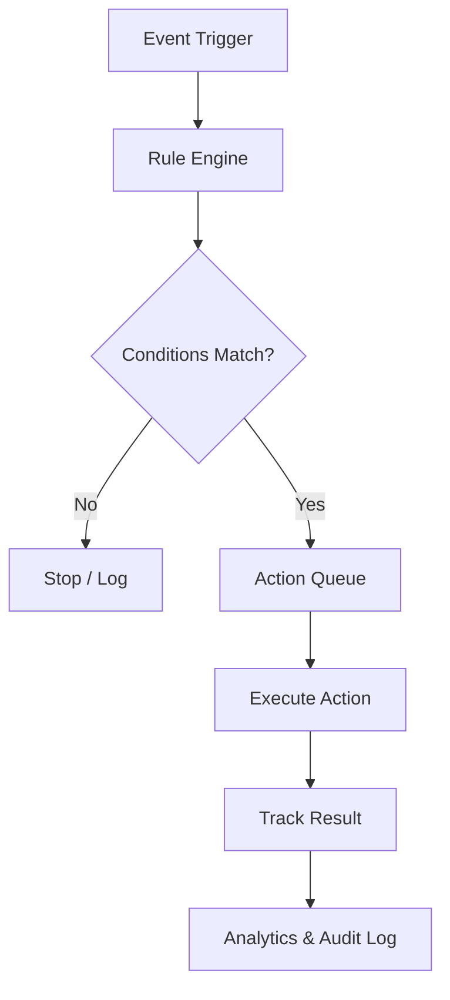

# Complete Multi-Vendor E-Commerce Platform Specification

A comprehensive feature and module specification for a scalable multi-vendor marketplace, covering the Admin Panel, Vendor Panel, Customer-Facing Website, automated SEO, automated marketing, analytics, integrations, and platform operations.

The platform should support dynamic configuration wherever possible, allowing administrators to manage products, vendors, campaigns, SEO rules, promotions, and workflows without code changes.

## 1. Admin Panel

### 1.1 Dashboard & Analytics
- Total revenue, gross sales, net sales, orders, commissions, refunds, and payouts
- Orders by status, payment method, vendor, and date
- Total vendors, active vendors, pending applications, and suspended vendors
- Total customers, new registrations, returning customers, and customer lifetime value
- Product counts by status, category, and stock availability
- Sales charts: hourly, daily, weekly, monthly, and yearly
- Top-selling products, categories, brands, and vendors
- Conversion rate, average order value, and cart abandonment rate
- Low-stock, out-of-stock, and pending-approval alerts
- Recent orders, reviews, vendor applications, and support tickets
- Custom dashboard widgets and date filters

### 1.2 Vendor Management
- Vendor registration and application review
- Approve, reject, suspend, reactivate, or terminate vendors
- Vendor profile, logo, banner, description, and storefront settings
- Business registration, identity, and tax document verification
- Vendor-specific commission rules
- Vendor subscription plans and listing limits
- Vendor performance, sales, ratings, and fulfillment metrics
- Vendor staff accounts and permissions
- Vendor onboarding checklist and status tracking
- Vendor notifications and internal notes
- Vendor-specific shipping, return, and refund policies

### 1.3 Product & Catalog Management
- Create, edit, approve, reject, archive, and delete products
- Physical, digital, downloadable, configurable, and bundled products
- Simple and variable products
- Product categories, subcategories, brands, tags, and collections
- Attributes, specifications, and variation options
- Product images, galleries, videos, and documents
- SKU, barcode, inventory, and stock alerts
- Regular price, sale price, scheduled pricing, and vendor pricing
- Bulk import/export through CSV or Excel
- Product approval workflow and rejection reasons
- Product status: draft, pending, published, rejected, and archived
- Product duplication and bulk editing
- Product SEO fields and structured data
- Featured products, badges, and merchandising rules

### 1.4 Category, Brand & Attribute Management
- Hierarchical categories and subcategories
- Category descriptions, images, icons, and banners
- Category-specific attributes and filters
- Brand profiles, logos, descriptions, and brand pages
- Product tags and collections
- Attribute types: text, number, dropdown, multi-select, color, and size
- Dynamic category forms and required attributes
- Category-level SEO templates and metadata

### 1.5 Order Management
- View and manage all marketplace orders
- Vendor-based order splitting and fulfillment
- Order status workflow and custom statuses
- Filter by customer, vendor, date, status, payment, and shipping
- Order notes and internal comments
- Invoice, packing slip, and shipping label generation
- Shipment tracking and delivery confirmation
- Cancellation, return, exchange, and refund management
- Partial refunds and vendor-specific refunds
- Dispute and chargeback tracking
- Order audit history and status timeline
- Bulk order actions and exports

### 1.6 Commission, Payments & Payouts
- Global, vendor-specific, and category-specific commissions
- Fixed, percentage-based, or mixed commission rules
- Commission tiers and vendor subscription-based rates
- Platform fees, transaction fees, and service charges
- Vendor gross earnings, deductions, and net earnings
- Pending, available, reserved, and paid balances
- Payout requests, approval, rejection, and processing
- Scheduled payouts and minimum payout thresholds
- Manual payouts and payout reconciliation
- Payment gateway transaction logs
- Refund and chargeback deductions
- Vendor financial statements and downloadable reports

### 1.7 Customer Management
- Customer profiles and account status
- Order history, returns, refunds, and support interactions
- Customer groups and segmentation
- Customer lifetime value and purchase frequency
- Saved addresses and preferences
- Customer account suspension and deletion
- Marketing consent and communication preferences
- Customer notes and activity timeline

### 1.8 Shipping & Fulfillment
- Shipping zones, countries, states, and postal codes
- Flat-rate, free, weight-based, and price-based shipping
- Vendor-specific shipping methods
- Shipping classes and product-level shipping rules
- Carrier integrations and shipping rate APIs
- Shipping labels, manifests, and tracking
- Estimated delivery dates
- Local delivery, pickup, and warehouse fulfillment
- Shipping rules for mixed-vendor carts

### 1.9 Payment & Tax Configuration
- Payment gateway setup and credentials
- Credit/debit cards, PayPal, Stripe, COD, and regional methods
- Payment status and reconciliation
- Multi-currency settings and exchange rates
- Country- and region-specific tax rules
- VAT, GST, and sales tax
- Tax-inclusive and tax-exclusive pricing
- Tax exemptions and tax reporting

### 1.10 Promotions & Discounts
- Platform-wide and vendor-specific coupons
- Percentage, fixed amount, and free-shipping discounts
- Buy-one-get-one and bundle offers
- Cart-level and product-level discounts
- Minimum spend and usage limits
- Customer group and vendor eligibility rules
- Scheduled promotions and flash sales
- Coupon stacking and exclusion rules
- Automatic discounts based on cart conditions

### 1.11 Reviews & Moderation
- Product and vendor reviews
- Review approval, rejection, and removal
- Reported review management
- Verified-purchase badges
- Vendor responses and moderation
- Rating analytics and review summaries

### 1.12 CMS & Website Content
- Homepage builder with configurable sections
- Banner, slider, and promotional content management
- Landing pages and campaign pages
- About, Contact, FAQ, Terms, Privacy, and Returns pages
- Blog and article management
- Navigation menus, mega menus, and footer links
- Announcement bars and promotional popups
- Page scheduling and preview
- SEO fields for all CMS pages

### 1.13 Support & Communication
- Customer and vendor support tickets
- Ticket categories, priorities, assignments, and statuses
- Admin-vendor messaging
- Admin-customer messaging
- Email, SMS, and push notification templates
- Automated notifications and escalation rules
- FAQ and knowledge base management

## 2. Vendor Panel

### 2.1 Vendor Dashboard
- Sales, orders, earnings, commissions, and payout overview
- Order status charts and product performance
- Top-selling products and customer trends
- Store rating and review summary
- Inventory and low-stock alerts
- Pending product approvals
- Payout balance and transaction history

### 2.2 Store Profile & Settings
- Store name, logo, banner, and description
- Business, contact, and tax details
- Store address and service areas
- Shipping, return, and refund policies
- Store SEO settings and social links
- Vacation mode and store availability
- Store verification status

### 2.3 Product Management
- Add, edit, duplicate, and archive products
- Submit products for approval
- Manage categories, brands, attributes, and variations
- Upload product images, videos, and documents
- SKU, barcode, pricing, and inventory management
- Sale prices and scheduled discounts
- Bulk product import/export
- Product SEO fields and preview
- Product approval status and admin feedback

### 2.4 Vendor Order Management
- View orders containing vendor products
- Process and fulfill vendor order items
- Update fulfillment status
- Print invoices and packing slips
- Add shipment tracking details
- Handle cancellations, returns, and exchanges
- Communicate with customers about orders
- View vendor-specific order history

### 2.5 Earnings & Payouts
- Gross sales, platform commissions, fees, and net earnings
- Pending, available, reserved, and paid balances
- Payout requests and payout account management
- Payout status and history
- Downloadable financial statements
- Refund and chargeback deductions

### 2.6 Vendor Marketing
- Create vendor coupons and discount codes
- Participate in platform-wide campaigns
- Schedule product sale prices
- Submit products for featured placements
- View coupon and campaign performance
- Share store and product links
- Manage customer questions and review responses

### 2.7 Vendor Reports & Staff
- Sales, orders, products, inventory, and customer reports
- Date and product filters
- CSV/Excel exports
- Vendor staff accounts and role permissions
- Notification preferences
- Store activity logs

## 3. Customer-Facing Website

### 3.1 Homepage
- Responsive desktop, tablet, and mobile layouts
- Search with autocomplete and suggestions
- Category navigation and mega menu
- Dynamic banners, sliders, and campaign sections
- Featured products, brands, and vendors
- New arrivals, best sellers, and trending products
- Deals, flash sales, and seasonal promotions
- Recently viewed products
- Personalized recommendations

### 3.2 Product Discovery
- Browse by category, brand, vendor, and collection
- Search by product name, SKU, brand, and keywords
- Filters for price, rating, availability, attributes, and vendor
- Sorting by price, popularity, rating, and newest
- Product comparison
- Wishlist and favorites
- Search suggestions and typo tolerance

### 3.3 Product Detail Pages
- Product title, description, and specifications
- Image gallery, zoom, and video
- Variations such as size and color
- Price, sale price, and discounts
- Stock availability and SKU
- Vendor/store details and rating
- Shipping cost and delivery estimate
- Returns, warranty, and product policies
- Product reviews and questions
- Add to cart and buy now
- Related products and recommendations

### 3.4 Vendor Storefronts
- Individual vendor store pages
- Store logo, banner, profile, and policies
- Vendor product catalog
- Store search, filters, and sorting
- Store ratings and reviews
- Contact vendor and ask a question
- Follow/favorite a store

### 3.5 Cart & Checkout
- Add, update, and remove cart items
- Cart grouped by vendor
- Guest and registered-user checkout
- Multiple shipping addresses
- Vendor-specific shipping options
- Coupons and automatic discounts
- Tax, shipping, and total calculations
- Multiple payment methods
- Order review and confirmation
- Secure payment processing

### 3.6 Customer Account
- Registration, login, password reset, and optional social login
- Profile and address management
- Order history and order tracking
- Reorder previous purchases
- Wishlist and saved products
- Return, cancellation, exchange, and refund requests
- Reviews and ratings
- Saved payment methods where supported
- Notification preferences
- Privacy controls and account deletion

### 3.7 Trust & Support
- Customer service contact form
- Live chat or chatbot
- Help center and FAQs
- Verified vendor badges
- Verified-purchase reviews
- Secure checkout indicators
- Privacy, terms, shipping, and return policies

## 4. SEO Module — Automated & Dynamic

The SEO module manages technical SEO, on-page SEO, structured data, content optimization, and search-engine indexing dynamically across products, categories, brands, vendors, and CMS pages.

### 4.1 SEO Dashboard
- Organic traffic, impressions, clicks, CTR, and average search position
- Indexed and non-indexed page counts
- SEO health score and technical issue summary
- Missing metadata and duplicate content alerts
- Broken links and redirect reports
- Top-performing pages and keywords
- Search Console integration
- SEO task queue and automation history

### 4.2 Dynamic Metadata Management
- Global title and description templates
- Product, category, brand, vendor, and CMS page templates
- Dynamic variables such as product name, brand, category, and store name
- Automatic meta title and description generation
- Character-length validation and preview
- Canonical URL generation
- Open Graph and social sharing metadata
- Twitter/X card metadata
- Robots meta directives
- Per-page overrides
- Duplicate metadata detection

Example templates:

```text
Product title:
{product_name} | Buy Online at {store_name}

Product description:
Shop {product_name} by {brand}. Explore features, pricing, and delivery options at {store_name}.
```

### 4.3 Automated Product SEO
- Generate SEO-friendly product titles and descriptions
- Suggest target keywords from product attributes
- Generate image alt text
- Create SEO-friendly product slugs
- Detect missing product descriptions
- Identify duplicate or thin product content
- Recommend internal links to related products and categories
- Generate product FAQ suggestions
- Preview search snippets before publishing

### 4.4 Category, Brand & Vendor SEO
- Dynamic category and subcategory metadata
- Category introduction and SEO content generation
- Brand landing page descriptions
- Vendor storefront metadata and descriptions
- SEO-friendly URLs for categories, brands, and stores
- Category-specific schema and breadcrumbs
- Automated internal links between related pages

### 4.5 Technical SEO Automation
- XML sitemap generation and automatic updates
- Separate sitemaps for products, categories, brands, vendors, and CMS pages
- Robots.txt management
- Canonical URL management
- Redirect manager (301, 302, 410)
- Broken-link detection
- Duplicate URL detection
- Pagination and filter URL handling
- Faceted navigation indexing rules
- HTTPS and mixed-content checks
- Mobile usability and page-speed monitoring
- Image optimization and lazy loading
- Core Web Vitals monitoring
- Structured data validation

### 4.6 Structured Data
Automatically generate and update JSON-LD schema for:
- Organization
- WebSite and SearchAction
- Product and ProductGroup
- Offer and AggregateOffer
- BreadcrumbList
- Review and AggregateRating
- Article and BlogPosting
- LocalBusiness, where applicable
- FAQPage, where eligible and supported by search engines

Schema values must come from actual database data, not fabricated ratings, prices, availability, or reviews.

### 4.7 SEO Content & Blog Automation
- SEO blog and article editor
- Keyword and topic suggestions
- AI-assisted outlines and drafts
- Meta title, description, and heading suggestions
- Internal link recommendations
- Content calendar and scheduled publishing
- Duplicate content checks
- Content refresh reminders
- Editorial approval workflow

### 4.8 SEO Rules & Automation Engine
- Rules using triggers, conditions, and actions
- Auto-generate metadata when products are created or updated
- Refresh metadata when prices, brands, or categories change
- Auto-create redirects when slugs change
- Regenerate sitemaps after publishing or deleting content
- Detect missing alt text and generate suggestions
- Notify admins about critical SEO issues
- Manual review, automatic publishing, or approval-based automation

### 4.9 SEO Integrations & Reporting
- Google Search Console
- Google Analytics 4
- Bing Webmaster Tools
- Search performance reports
- Keyword and landing-page tracking
- SEO task history and change logs
- CSV/Excel report exports

## 5. Marketing Module — Automated & Dynamic

The marketing module creates campaigns and automates customer engagement based on behavior, purchase history, cart activity, and product/vendor events.

### 5.1 Marketing Dashboard
- Campaign revenue and conversion rate
- Email and SMS delivery, open, and click rates
- Coupon usage and discount costs
- Customer acquisition and retention metrics
- Abandoned cart value
- Campaign performance by vendor, product, and channel
- ROI and revenue attribution

### 5.2 Campaign Management
- Create, edit, schedule, pause, and end campaigns
- Seasonal, product launch, clearance, and flash-sale campaigns
- Audience segmentation and eligibility rules
- Email, SMS, push, onsite banners, and popups
- Campaign templates and reusable designs
- A/B testing for subject lines, content, and offers
- Campaign approval workflow
- Campaign history and performance reports

### 5.3 Coupon & Promotion Engine
- Percentage, fixed amount, and free-shipping coupons
- Automatic discounts without coupon codes
- Product, category, vendor, and cart-level discounts
- Buy-one-get-one and bundle offers
- Minimum spend and quantity requirements
- Customer-specific and first-order offers
- Usage limits and expiration dates
- Coupon stacking and exclusion rules
- Scheduled promotions and flash sales
- Dynamic discount rules based on cart conditions

### 5.4 Customer Segmentation
- New, returning, and inactive customers
- High-value and frequent customers
- Customers by location, language, and currency
- Customers by product/category purchase history
- Customers by average order value
- Customers who viewed products or abandoned carts
- Customers by marketing consent
- Saved dynamic segments that update automatically

### 5.5 Marketing Automation Workflows
Build a visual workflow system using **trigger → conditions → actions → delay → next step**.

Example workflows:
- Welcome series after registration
- Abandoned-cart reminders
- Browse-abandonment reminders
- Order confirmation and post-purchase follow-up
- Review request after delivery
- Reorder reminders for repeat-purchase products
- Win-back campaigns for inactive customers
- Birthday or anniversary offers, when dates are provided
- Back-in-stock notifications
- Price-drop alerts for wishlist products
- Loyalty milestone rewards
- Vendor-specific campaigns, subject to platform rules

Automation controls:
- Workflow enable/disable and scheduling
- Audience eligibility and consent checks
- Frequency caps and quiet hours
- Retry rules and failure notifications
- Unsubscribe and suppression lists
- Workflow logs and performance analytics

### 5.6 Email, SMS & Push Notifications
- Email template builder
- SMS templates and provider integration
- Web push and mobile push integration
- Dynamic personalization fields
- Multi-language templates
- Transactional versus promotional message separation
- Delivery logs, retries, and bounce handling
- Consent management and unsubscribe links

### 5.7 On-Site Marketing
- Homepage promotional banners
- Targeted popups and announcement bars
- Exit-intent offers
- Personalized product recommendations
- Recently viewed and trending products
- Dynamic landing pages
- Countdown timers tied to real campaign schedules
- Location- or segment-based offers

### 5.8 Loyalty, Referral & Affiliate Marketing
- Loyalty points and rewards
- Earn and redeem rules
- Referral links and referral rewards
- Affiliate registration and tracking
- Affiliate commissions and payouts
- Gift cards and store credit
- Reward expiration and fraud controls

### 5.9 Marketing Integrations
- Google Analytics 4
- Google Ads conversion tracking
- Meta Pixel and Conversions API
- Google Merchant Center product feeds
- Email marketing providers
- SMS providers
- Web push providers
- Affiliate tracking platforms
- Consent-aware tracking and tag management

### 5.10 Marketing Automation Rules
- Triggers: customer registered, order placed, cart abandoned, product viewed, stock replenished
- Conditions: customer segment, order value, vendor, category, location, consent
- Actions: send email/SMS/push, apply coupon, add to segment, notify vendor, display banner
- Delays: minutes, hours, days, or scheduled time
- Branches: opened email, clicked link, purchased, or did not purchase
- Testing mode, audit logs, and manual override

## 6. Inventory & Warehouse Module
- Inventory by product, vendor, warehouse, and location
- Stock reservations during checkout
- Low-stock and out-of-stock alerts
- Backorders and preorders
- Stock adjustment history
- Purchase orders and supplier management
- Warehouse transfers
- Batch and serial number tracking, if needed
- Inventory forecasting and replenishment suggestions
- Multi-warehouse fulfillment

## 7. Reports & Business Intelligence
- Sales, revenue, commission, payout, and refund reports
- Vendor performance and fulfillment reports
- Product, category, and brand reports
- Customer acquisition and retention reports
- Inventory and stock movement reports
- SEO performance and organic conversion reports
- Marketing campaign and attribution reports
- Tax and payment reconciliation reports
- Custom date filters and exports
- Scheduled reports by email

## 8. Platform Settings & Security
- General settings, branding, and theme configuration
- Multi-language and localization settings
- Multi-currency and exchange-rate settings
- Admin roles and granular permissions
- Vendor staff permissions
- Two-factor authentication
- Login and session controls
- Activity logs and audit trails
- Rate limiting and fraud prevention
- Data backups and recovery
- Privacy, consent, and data retention settings
- Maintenance mode and system health monitoring

## 9. Suggested Technical Module Structure

| Module | Core components |
|---|---|
| Users & Access | Admins, vendors, customers, roles, permissions |
| Marketplace | Vendors, storefronts, subscriptions, commissions |
| Catalog | Products, variants, categories, brands, attributes |
| Orders | Cart, checkout, orders, fulfillment, returns |
| Payments | Gateways, transactions, refunds, payouts |
| Shipping | Zones, rates, carriers, tracking |
| Inventory | Warehouses, stock, reservations, suppliers |
| Promotions | Coupons, discounts, flash sales, bundles |
| CMS | Pages, banners, menus, blogs, landing pages |
| SEO | Metadata, sitemaps, schema, redirects, SEO rules |
| Marketing | Campaigns, segments, workflows, messaging |
| Analytics | Reports, dashboards, attribution, exports |
| Support | Tickets, chat, FAQs, notifications |
| Integrations | Payment, shipping, analytics, marketing APIs |
| System | Settings, logs, security, backups |

## 10. Recommended Automation Architecture

Build SEO and marketing automation as reusable rule-based engines instead of hardcoding each workflow.



### Automation Engine Capabilities
- Event-driven triggers and scheduled jobs
- Dynamic conditions and reusable actions
- Queue-based execution and retries
- Approval gates for sensitive actions
- Workflow versioning and audit logs
- Duplicate-event protection
- Rate limits and frequency caps
- Monitoring, failure alerts, and manual replay

**Important:** Automate repetitive work, but keep approval controls for high-impact changes such as bulk product publishing, large discounts, SEO redirects, and mass customer messaging. This helps prevent accidental price changes, misleading SEO content, and unwanted marketing messages.
